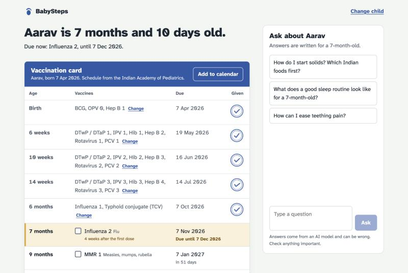

# BabySteps

A vaccination card, a milestone checklist and a question box for parents in India, all worked out from
one date of birth.

**Live:** _add the Netlify link here_



## What it does

Enter a child's name and date of birth and the app:

- fills in the IAP vaccination schedule with real dates. Tick doses as they're given, and a visit gets a
  stamp once every dose in it is done. Upcoming visits export to your calendar as an `.ics` file.
- lists the milestones most children reach by the current age, with a preview of the next stage.
- answers questions for the child's exact age. Answers stream from Gemini through a Netlify Function.

There is no account and no database. The child's details and checklists live in `localStorage`; only chat
questions leave the browser.

## Stack

React 18, TypeScript (strict, with `noUncheckedIndexedAccess`), Vite, plain CSS. A single Netlify Function
(`netlify/functions/ask.mts`) handles the AI calls. Tests run on Vitest, linting on ESLint with
`typescript-eslint` strict and the React Hooks rules.

## How the AI endpoint works

`POST /api/ask` takes the conversation and the child's age, and returns the answer as a plain-text stream.

1. Validates the body: 1 to 12 messages, each under 1,500 characters, starting and ending with the user.
   The child's name and age are sanitised before they go into the system prompt.
2. Rate-limits each IP to 12 requests a minute and returns `429` with `Retry-After`. The limit is held in
   memory per function instance, which is fine for a demo; a real product would use a shared store.
3. Calls Gemini's `streamGenerateContent` with a 45-second timeout.
4. Turns Gemini's server-sent events into plain text chunks. Network chunks can split an event in half, so
   the incomplete tail is held until the next chunk arrives.

The system prompt tells the model to answer for that age and for Indian homes, never to diagnose or give
doses, and to stop and say "call 112" when a question describes a danger sign.

The browser renders answers with a small Markdown renderer that builds React elements rather than setting
`innerHTML`.

## Running it

```bash
npm install
npm run dev     # http://localhost:5173. The question box needs the function, see below.
npm run check   # types, lint, formatting and tests
```

To run the function locally, use the Netlify CLI with a key from
[Google AI Studio](https://aistudio.google.com/apikey):

```bash
cp .env.example .env    # then set GEMINI_API_KEY
npx netlify-cli dev     # app and /api/ask on http://localhost:8888
```

## Deploying

Import the repo in Netlify; `netlify.toml` already has the build settings. Then add `GEMINI_API_KEY` under
Site configuration → Environment variables and redeploy. `GEMINI_MODEL` is optional and defaults to
`gemini-2.5-flash`.

## How I built it

I built this with Claude Code as a pair programmer, over a handful of prompts. I set the brief and the
scope and checked the vaccine and milestone data against the sources below. The agent wrote most of the
first version and ran it in a browser preview. That pass found a chat bug, where a failed request left a
duplicate question in the thread, and a demo that opened on "5 visits overdue". Both were fixed.

I then had it rework the design and the code against two references: Anthropic's frontend-design guidelines
for the look, and a checklist of common AI-code problems for the code. That pass did three things:

- replaced the stock card layout with the vaccination card;
- added strict TypeScript, lint rules that fail the build, and tests that pin down the date logic and the
  streaming endpoint;
- removed comments that only narrated the code.

## Sources

- Vaccines: Indian Academy of Pediatrics, ACVIP immunization schedule (2023), simplified.
- Milestones: adapted from the CDC's "Learn the Signs. Act Early." checklists (2022).

BabySteps gives general information, not medical advice.
